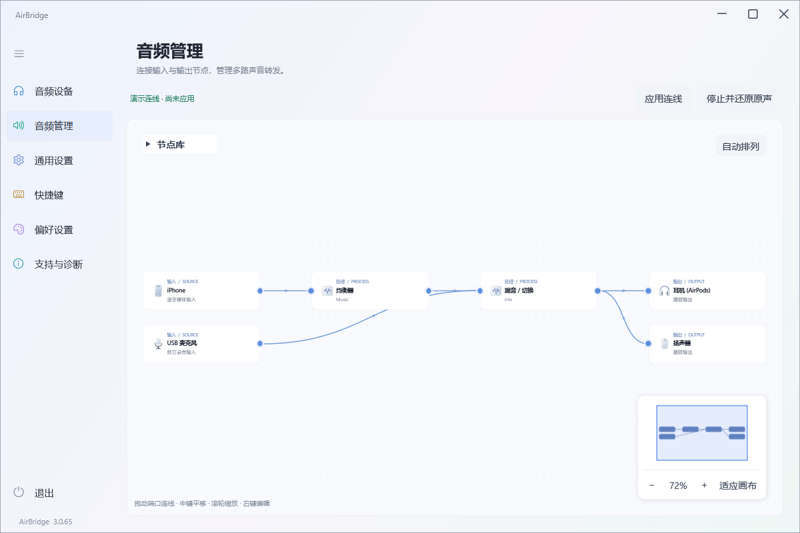
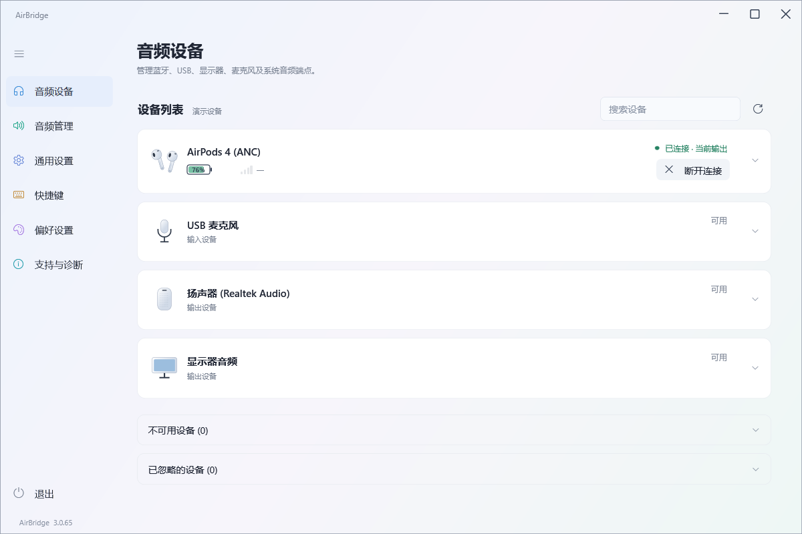

<div align="center">

# AirBridge

**把手机与电脑的声音，连接到你想用的耳机和音箱。**

Windows 音频路由 · 蓝牙手机输入 · 可视化节点图 · 可选效果链

[](https://github.com/xxxxkq/AirBridge/releases/latest)
[](#运行环境)
[](#从源码构建)
[](LICENSE)

[**下载正式版**](https://github.com/xxxxkq/AirBridge/releases/latest) · [快速开始](#快速开始) · [功能与限制](#功能与限制) · [提交问题](https://github.com/xxxxkq/AirBridge/issues) · [开发文档](docs/DEVELOPMENT.md)

A Windows audio routing app with Bluetooth phone inputs and a visual audio graph.

</div>



> 预览使用当前源码的真实 WPF 控件离屏渲染，设备、数值与连线为演示数据，并非实机测试结果。文档跟随 `main`；正式下载包以对应 Release 标签为准。

## 能做什么

- **接收手机媒体音频**：将兼容的 iPhone / Android 手机通过蓝牙接入电脑，再送到耳机或音箱；也可与电脑声音一起播放。
- **用节点图管理声音**：添加输入、处理组件和输出，拖动端口连线；支持节点编辑、右键菜单、自动排列、缩放和小地图。
- **组合音频处理**：混音 / 切换、均衡器、音量、静音、变声、回声、限幅、WAV 录音，以及 RTP/UDP 网络输入与输出。
- **管理系统音频设备**：集中查看蓝牙、USB、显示器、麦克风与扬声器，调节音量、静音 / 闭麦、选择输出、忽略不常用设备。
- **查看耳机与手机状态**：显示可读取的电量、广播信号和每台手机近 10 秒缺音率；为已适配型号提供独立佩戴检测开关。
- **在后台使用**：托盘快捷面板、快捷键、开机自启、记忆连线、中英文与主题设置，以及可选择开启的 GitHub 更新检查。

AirBridge 使用 **C# + WPF** 和原生 **C++** 采集模块，运行时不调用 PowerShell。默认功能不要求额外安装虚拟声卡；电脑 / 应用的效果链与多输出可通过 **VB-CABLE 可选扩展**启用。

## 界面预览

<details>
<summary><strong>音频设备：统一设备卡片、电量与输入 / 输出控制</strong></summary>



设备设置在卡片右侧箭头中展开；不可用设备与已忽略设备默认收起。图中电量和连接状态为演示数据。

</details>

## 下载与运行

从 [GitHub Releases](https://github.com/xxxxkq/AirBridge/releases/latest) 下载 **`AirBridge.exe`**，放入一个可写的独立文件夹后双击运行。

- 正式分发是单文件 EXE，无需下载源码或安装开发工具。
- 可使用 Release 附带的 `SHA256.txt` 核对文件完整性。
- **不要从 `build/` 复制同名 EXE 作为单文件版**：那是需要配套 DLL 的内部运行组件。
- 当前正式包未做发布者数字签名，Windows 可能提示未知发布者；请核对下载来源。

### 运行环境

主要开发与验证环境为 **Windows 11 x64 + .NET Framework 4.8**。蓝牙接收需要电脑的蓝牙适配器、Windows 蓝牙音频支持，以及手机开启媒体音频输出；设备控制与低延迟能力取决于实际硬件和驱动。

Windows 10、不同蓝牙适配器及各品牌手机尚未完成完整兼容性覆盖。不保证所有设备都能读取电量、识别广播或同时稳定播放多路蓝牙音频。

## 快速开始

1. **配对手机**：在 Windows 蓝牙设置中完成配对，在手机上确认这台电脑的“媒体音频”可用。
2. **打开连接**：进入「音频设备」，找到手机，点击「打开连接」。在手机的媒体输出列表中选择这台电脑。
3. **安排声音路径**：进入「音频管理」，从左上角节点库添加手机输入和耳机 / 音箱输出，拖动端口连线；需要时加入均衡器或其他组件。
4. **应用连线**：点击「应用连线」，然后在手机上播放音乐或视频。编辑图后需再次应用才能改变运行路径。
5. **停止与退出**：点击「停止并还原原声」停止转发；右上角关闭窗口会收起至托盘，左侧底部「退出」才会完全关闭。

初始画布只有 **电脑媒体声音 → 系统默认播放器**。启动可恢复上次成功运行的图；手动停止后，下次启动不会自动恢复该图。设备未就绪的路径会等待，不应阻止其他可用路径运行。

## 功能与限制

不同来源的路由能力不同，尤其要区分“改变应用输出设备”与“捕获应用声音并进行处理”。

| 来源 | 默认可用 | 效果链 / 多输出 |
| --- | --- | --- |
| 蓝牙手机媒体音频 | 独立手机通道，进入节点图 | 支持；实际双手机稳定性受蓝牙链路影响 |
| 麦克风等系统录音端点 | 作为输入节点加入图 | 支持 |
| 电脑整体媒体音频 | Windows 原生单输出路由 | 需要启用 VB-CABLE 扩展 |
| 单个应用音频 | Windows 原生单输出路由 | 需要启用 VB-CABLE 扩展，且该应用响应输出切换 |

### VB-CABLE 是可选扩展

需要处理电脑整体或单个应用的音频时，可自行安装 [VB-Audio 官方 VB-CABLE](https://vb-audio.com/Cable/)，再到「通用设置」开启扩展。AirBridge **不捆绑、不自动安装**该驱动。

- **一条虚拟线同时只能隔离电脑整体音频或一个应用**，不能同时分离多个应用或同时隔离电脑与应用。
- 系统或所选应用的输出会临时送入虚拟端点，再由 AirBridge 按图处理与播放；停止或退出时尝试恢复接管前的输出。
- 保留独立恢复守护与恢复记录，用于处理异常退出。原设备断开或系统拒绝设置时，可能需要设备重新就绪才能完成恢复。

### 当前边界

- **手机输入接收的是媒体音频**，不转接电话、语音通话或手机麦克风。
- **蓝牙不是零延迟链路**。双手机输入再向蓝牙耳机输出时，部分组合仍可能卡顿；自适应缓冲在流畅性与延迟之间取舍，不能补足持续缺失的音频。
- **电量 / 信号依赖设备暴露的数据**。无数据时显示 `—`；广播信号不是音频丢包率。近 10 秒缺音率按播放需求中的实际补零量计算，正常暂停显示“等待音频”。
- **佩戴检测只提供给已适配的广播型号**，可能漏检；Windows 媒体暂停 / 恢复与手机播放器控制并不等价。不提供 AAP 驱动或降噪 / 通透控制。
- **RTP/UDP 当前为基础 L16 / 44.1 kHz / 双声道方案**，不含公网穿透或加密，适用于可信网络。

更多问题与验证边界见 [项目进度](docs/PROGRESS.md)。

## 配置、日志与更新

- `main` 中的新安装默认把配置、日志、缓存与更新文件放在 **EXE 旁的 `Data/`**；目录不可写时提示并回退到 Windows 用户目录。
- **已发布的 v3.0.65 尚未包含上述默认目录调整**。已有配置、位置描述文件与恢复记录会继续保留；可在「偏好设置 → 数据保存位置」选择迁移或自定义目录。
- 单文件不代表不产生数据文件。分享给别人时只分享正式 EXE，**不要附带自己的 `Data/` 或 `AirBridge.storage.xml`**。
- 自动检查更新默认关闭。开启后每 12 小时检查 GitHub Releases，不自动下载或安装；支持本次跳过、今日跳过、忽略版本和禁止更新。

详情：[数据位置与迁移](docs/STORAGE.md) · [更新流程与恢复](docs/UPDATING.md)

## 从源码构建

需要 Windows x64、.NET Framework 4.8 编译环境、**Visual Studio 2022 Build Tools / Visual Studio 的“使用 C++ 的桌面开发”**工作负载，以及 Windows SDK。构建脚本使用 PowerShell；这是开发依赖，程序运行时不需要它。

```powershell
git clone https://github.com/xxxxkq/AirBridge.git
cd AirBridge

# 开发构建：保留自检与实验入口
powershell -NoProfile -ExecutionPolicy Bypass -File .\Build.ps1 -Configuration Development

# 离线音频检查，不打开真实音频设备
powershell -NoProfile -ExecutionPolicy Bypass -File .\Scripts\Test-Offline.ps1 -Release .\build\dev

# 正式单文件：编译移除自检、故障模拟和实验入口
powershell -NoProfile -ExecutionPolicy Bypass -File .\Build.ps1 -Configuration Release -SingleFile
```

开发运行组件位于 `build/dev/`，正式单文件位于 `artifacts/single-file/AirBridge.exe`。NAudio 2.2.1 依赖已随源码固定，许可证见第三方声明。日常维护不为每次小修改提高版本号，阶段性发布才统一升版。

完整说明：[开发与发布](docs/DEVELOPMENT.md) · [构建类型](docs/BUILD-VARIANTS.md) · [项目规则](AGENTS.md)

## 参与贡献

欢迎 [提交 Issue](https://github.com/xxxxkq/AirBridge/issues) 或 Pull Request。提交音频问题时，请提供 Windows 版本、AirBridge 版本、蓝牙适配器、手机 / 耳机型号、连线方式、缓冲开关及复现步骤；分享日志前先移除设备地址、个人路径与其他隐私信息。

修改前阅读 [AGENTS.md](AGENTS.md)，为连接管理、音频处理及输出恢复改动补充适当的离线回归，并区分“离线通过”与“实机试听通过”。仅修改文档不需要重启或连接音频设备。

### 项目结构

```text
Core/          设备模型与能力描述
Platform/      Windows 平台接口、采集、路由、DSP 与网络音频
Desktop/       WPF 应用逻辑、托盘、设置与更新
UI/  Assets/   界面、节点画布、动画与资源
Shared/        启动器与运行组件共用的数据位置逻辑
Packaging/     正式单文件封装
Tests/ Scripts/ 测试、构建与维护工具
docs/          开发流程、项目进度、设计记录与界面预览
Optional/      已停止的驱动研究；不进入默认构建或正式分发
```

[项目进度](docs/PROGRESS.md) · [设计决策](docs/DECISIONS.md) · [历史变更](README.txt) · [开源与分发](docs/OPEN-SOURCE.md)

## 许可与致谢

AirBridge 自有源码采用 **[GNU GPL-3.0-only](LICENSE)**。修改后分发时须遵守 GPL 的源码提供等条件；第三方文件保留原有版权与许可，详见 [THIRD-PARTY-NOTICES.txt](THIRD-PARTY-NOTICES.txt)。

感谢 [NAudio](https://github.com/naudio/NAudio) 提供音频基础设施，以及 [AirPodsDesktop](https://github.com/SpriteOvO/AirPodsDesktop) 的公开协议研究参考。VB-CABLE 是独立第三方可选组件，按其自己的许可分发。

AirBridge 并非 Apple 官方软件，与 Apple、Microsoft 或 VB-Audio 不存在官方隶属关系。
